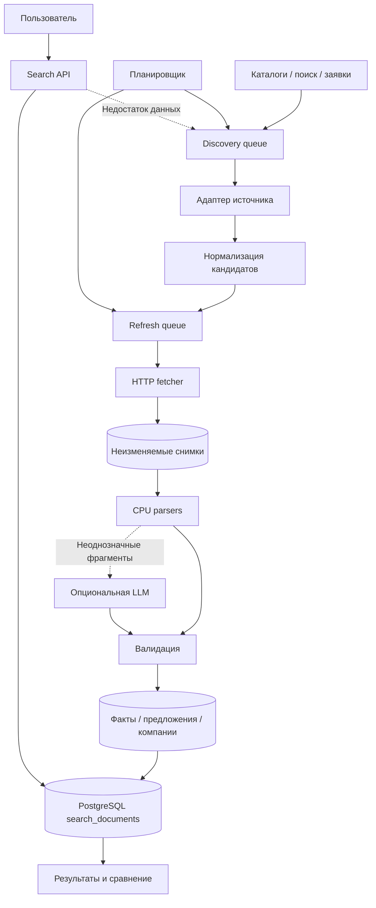

# Сервис поиска поставщиков: архитектура, проверка гипотезы и план

Дата проверки: 4 ноября 2026, Asia/Yekaterinburg.

## 1. Продукт и границы

Поиск поставщиков продуктов, ингредиентов и упаковки по товару и региону доставки. Пользователь получает сравнение, контакты, источники фактов, актуальность и вопросы для уточнения. Обязательный результат тестового: доступный прототип, репозиторий, пояснение. Цены, MOQ, документы и доставка полезны, но неизвестные данные допустимы и явно показываются.

Зафиксировано два независимых контура: онлайн-поиск по подготовленным данным и фоновое обнаружение/индексация. Онлайн не вызывает внешние сайты или LLM. Недостаточная выдача порождает фоновую заявку, не задерживая ответ.

## 2. Что реально проверено

Скрипты используют стандартную библиотеку Python, CPU, без API-ключей, браузера и LLM. Снимки и разобранный текст сохранены в poc/. Это ограниченный эксперимент, не массовая выгрузка.

- Продэкспо: страница списка HTTP 200; 10 ссылок на карточки на проверенной странице; каталог сообщает 1437 российских участников. Проверены 5 карточек, все HTTP 200; в 4 извлечён сайт. В одной сайт не найден: сохранять компанию как unresolved, искать отдельно по названию и адресу.
- WorldFood: новость ведёт на фактический HTML-каталог на exhibitoronlinemanual.com. Список и 3 карточки HTTP 200; из всех трёх извлечены сайты. Полный обход пагинации не реализован.
- СППИ: главная и 5 карточек HTTP 200; 5 сайтов извлечены. На странице явно написано «копирование информации только с разрешения администрации сайта». Регулярный импорт по умолчанию выключить до согласования условий; техническая доступность не означает разрешение на копирование.
- Неос: таймаут TLS; работоспособность дилерского канала программно не подтверждена.
- Всего 13 карточек каталогов → 12 кандидатов с различными доменами. Кандидаты не равны проверенным поставщикам: иностранные компании и химические предприятия требуют фильтрации.
- SQLite: сначала 9 вставок из Продэкспо/СППИ, затем 3 новые записи WorldFood. Повторный прогон: 0 вставок, 0 обновлений, 12 unchanged. Синтетическое изменение описания в отдельной in-memory базе: ровно 1 update.
- Три сайта поставщиков (food-fresh.ru, ingredico.ru, tkdip.ru): HTTP 200, соответственно 3/2/4 уникальные контактные ссылки. JSON-LD: 1/0/0 блоков; Product: 0/0/0. Наличие рубля или слова «доставка» сохраняется как evidence, не как готовое коммерческое условие.
- Поиск по 12 кандидатам: smoke-проверки шоколада, ароматизаторов, сыра и пустого результата. Это не замер качества промышленного поиска.

Доказано: известные шаблоны каталогов можно детерминированно разобрать, получить новые домены, повторно обработать снимки без дублей. НЕ доказано: непрерывная доступность, полнота каталогов, корректность всех товарных цен, производительность на тысячах сайтов, реальная актуальность компаний. Детерминированность относится к одному снимку и версии парсера; интернет меняется.

## 3. Источники

1. https://icatalog.expocentr.ru/ru/exhibitions/870c9c18-e84b-11ef-80ce-a0d3c1fab97f/countries/Россия?page=93
2. https://world-food.ru/ru/media/news/2026/august/12/uchastniki-worldfood-moscow-2026/
3. https://exhibitors-itegroup.exhibitoronlinemanual.com/worldfood-moscow-2026/ru/Exhibitor
4. https://sppiunion.ru/uchastniki/ — ограничение копирования выше.
5. https://neos-ingredients.ru/ — региональные партнёры, пока сетевой сбой.
6. Начальные 25 сайтов: results.json и report.md в этой папке.
7. Brave/Tavily/2GIS: дополнительные каналы discovery, реальные поисковые ответы с ключами не проверены. Документация и ответы ошибок API проверялись ранее.

Для каждого источника: adapter_id, edition/year, entry_url, enabled, terms_reviewed, robots_status, checkpoint, last_success, last_error, extraction_yield. Страница выставки прошлого года сохраняет историческую дату, даже если скачана сегодня.

## 4. Архитектура



MVP: один репозиторий, Next.js UI, Python worker/API или отдельный Python API, PostgreSQL. Очередь сначала в PostgreSQL с блокировкой заданий и lease; отдельный брокер после измерения нагрузки. Файловое/S3-хранилище снимков. SQLite используется только в PoC. Никаких обязательных GPU.

## 5. Регулярное обнаружение

Приоритетные каналы: каталоги выставок → региональные каталоги и API → дилерские сети → поисковая матрица категория × регион → пользовательские заявки/прайсы. Ссылка из футера на разработчика сайта не является поставщиком: нужны адаптеры смыслового блока, а не все внешние URL.

Обход каталога: читать фактические ссылки пагинации, сохранять seen IDs и checkpoint, ограничивать число страниц и бюджет; не угадывать ID компаний. Смена года создаёт новую edition. Периодически полный проход для предотвращения пропусков при перемещении компаний между страницами. Отсутствие записи в одном проходе не означает закрытие компании.

Состояния: discovered → fetched → classified → extracted → validated → published. Альтернативы: retry_pending, unresolved_website, rejected_irrelevant, review_required. Кандидат без сайта не теряется. На входе сохранять provenance.

Ключ наблюдения: source + edition + external_company_id. Параметр stand не должен создавать новую компанию. Домен — сигнал для объединения, не универсальный идентификатор юрлица. ИНН с валидной контрольной суммой и подтверждением лучше названия; филиалы хранить отдельно. В эксперименте две «ПЛАНЕТА ВКУСА, ООО» имеют разные города и домены — не объединены.

Распределение бюджета: спрос пользователей × дефицит покрытия × доля новых релевантных результатов / стоимость. Обнаружение и обновление имеют отдельные квоты. Каталоги стартово проверять еженедельно, активные мероприятия чаще; интервалы уточнять по фактическим изменениям.

## 6. Обновление и устойчивость

- До промышленного обхода проверить robots.txt, условия источника, разрешённые методы. В PoC robots автоматически не учитывается; скрипты ограничены небольшим числом запросов.
- Один активный запрос на домен, задержка, timeout, ограничение байтов. В production: Retry-After, exponential backoff с jitter, circuit breaker, DNS/HTTP-метрики.
- Не отключать TLS-проверку. Блокировки и CAPTCHA переводить в альтернативный источник или ручную проверку.
- ETag/Last-Modified при поддержке. Хеш исходного содержимого плюс хеш извлечённых значимых полей. Динамический счётчик не должен запускать обновление всех фактов.
- Снимки адресовать хешем содержимого, хранить fetch events отдельно. PoC сохраняет последний снимок по URL и не является историческим архивом.
- Каждому полю: value, raw_value, source_url, snapshot_hash, evidence/selector, observed_at, source_valid_at, parser_version, extraction_method, verification_status.
- Уникальные ключи и UPSERT; публикация новой версии атомарно после валидации. Повторное выполнение после сбоя безопасно.
- 304 обновляет last_checked, но не превращает старую цену в новую. Ошибка загрузки не обнуляет карточку. Истёкший факт получает stale.
- Начальные интервалы: контакты 30 дней, ассортимент 7 дней, цены 1–7 дней для востребованных предложений. Это настройки, не гарантия актуальности.
- Пользовательские URL: разрешать только публичные HTTP(S), запрещать private/loopback/link-local адреса и проверять каждый redirect; защита от SSRF обязательна до публичного приёма URL. PoC рассчитан на фиксированные доверенные URL.
- Текст сайта — недоверенные данные; если используется LLM, запрещено исполнение инструкций из страницы.

## 7. Парсинг под качественный поиск

Не индексировать всю страницу компании единым документом: меню перечисляет товары, которых может не быть в конкретном предложении; карточки каталога выставки содержат сотни соседних компаний. Адаптер должен отделять основной блок от навигации, похожих товаров и списка участников.

Каскад: JSON-LD Product/Offer → HTML CSS/XPath адаптер → таблицы CSV/XLSX → текстовый PDF → OCR только для сканов → LLM для небольшого остатка. JSON-LD проверять против видимого текста, не считать заведомо достоверным. Универсальные правила извлекают кандидаты фактов; специфичные правила связывают значение с товаром и условием.

Модель:
- suppliers: юрлицо/бренд, идентификаторы, сайты, контакты, роли;
- locations: офис, склад, производство — не география доставки;
- delivery_areas: подтверждённая зона обслуживания и источник;
- products: название, category_id, бренд, артикул, атрибуты, исходное название;
- offers: supplier_id/product_id, цена Decimal, валюта, единица, фасовка, НДС, MOQ и его тип, наличие, сроки, период действия;
- evidence: факты и происхождение;
- source_observations: история источника;
- search_documents: отдельный документ на предложение/товарную группу; уровень конкретности сохраняется.

MOQ заказа в рублях, MOQ позиции в килограммах и порог бесплатной доставки — три разных поля. Цена «от» — признак lower_bound. Нельзя пересчитать цену за коробку в цену за кг без массы. Упаковка требует объёма, материала, размеров, совместимости крышки; сыр — типа, жирности, назначения, фасовки. Неизвестное — null, а не false/0.

## 8. Простой сильный поиск

Первый движок — PostgreSQL FTS + pg_trgm + справочник категорий и синонимов. GIN для tsvector, отдельные индексы category/region, trigram для названия и словаря. Не применять fuzzy scan ко всему тексту каждого документа.

Поля интерфейса: «что нужно», регион доставки, объём/единица; уточняющие фильтры по категории. Разбор запроса детерминированный: словарь городов и сокращений, алиасы категорий, регулярные выражения единиц и чисел. Неоднозначность показывать пользователю. Поиск не зависит от LLM.

Нормализация: Unicode, регистр, ё/е, пробелы, единицы; сохранить оригинал. Русская конфигурация FTS для словоформ, simple для артикулов/брендов. Исправления опечаток — по словарю индексированных терминов с порогом и предложением пользователю.

Синонимы разделить на equivalence и related. «Моцарелла/моцарела» — алиасы; «шоколад/какао» — связанные, но не взаимозаменяемые товары. «Для пиццы» — назначение, не доказательство конкретного сорта сыра. Словарь версионировать.

Retrieval: точный артикул/название → FTS по товарам/категориям → расширение эквивалентными алиасами → fallback опечаток. Несовпадающие строгие ограничения не снимаются молча. Результаты неизвестной доставки показывать отдельно от подтверждённой. Город офиса не использовать как фильтр доставки.

Rank: сначала совпадение товара и обязательных атрибутов; затем выполнимость заказа/доставки; затем свежесть и полнота. Полнота не должна перевешивать неподходящий товар. Цена участвует только среди сопоставимых предложений. Группировать предложения по поставщику, показывать 1–3 релевантные позиции.

Пример: «моцарела 2 кг Екатеринбург» → corrected_term=моцарелла; package_mass=2 kg как гипотеза, регион доставки отдельно; уточнить, является ли 2 кг фасовкой или объёмом заказа. «Контейнер 500 мл с крышкой» → объём 500 ml, наличие крышки; не заменять на контейнер без крышки с совместимой крышкой в другом предложении.

Качество: золотой набор 50–100 запросов с релевантными товарами, опечатками, синонимами, региональными условиями, отрицаниями и пустой выдачей; Precision@5, nDCG@10, recall на размеченной выборке, доля корректных фильтров, p95 latency. Цель для MVP p95 <500 мс после загрузочного теста, не измеренный результат. До этой проверки не обещать «крутой поиск» только по наличию FTS.

Официальные источники: https://www.postgresql.org/docs/current/functions-textsearch.html ; https://www.postgresql.org/docs/17/pgtrgm.html ; https://schema.org/Product ; https://schema.org/Offer

## 9. Скрипты и воспроизведение

Из корня рабочего каталога:

```sh
python3 discover.py
python3 sample_catalogs.py
python3 enrich.py
python3 pipeline.py
python3 extract_supplier.py
python3 search_poc.py
```

Первые три команды требуют сеть; последующие работают по сохранённым снимкам. СППИ включён в ограниченный эксперимент; перед регулярным запуском отключить его либо получить согласованные условия. Никаких pip-зависимостей. probe.py — предыдущая проверка 25 сайтов.

Результаты: sources.json, catalog_samples.json, enrichment.json, candidates.json, supplier_facts.json, pipeline_report.json, search_report.json, suppliers.sqlite внутри poc/. Скрипты — PoC, не готовый crawler: нет автоматической пагинации, robots, retry scheduler, исторического архива, SSRF-фильтра, полноценной морфологии, товарных адаптеров и production-валидации. JSON с candidates не следует публиковать напрямую как проверенную базу.

## 10. План реализации и критерии приёмки

1. Закрепить источники и их условия; адаптеры Продэкспо/WorldFood, пагинация и сохранение ID. Проверка: не менее 100 карточек на источник, ручная проверка 20, отчёт пропусков.
2. PostgreSQL schema, очередь с lease, снимки, UPSERT и версионность. Проверка: повторы, сбой между стадиями, восстановление, изменение и удаление полей без потери истории.
3. Адаптеры 5–7 разных сайтов поставщиков, включая товарную карточку, доставку, PDF/XLSX. Проверка: 50–100 предложений с ручной разметкой, точность цена/единица/MOQ отдельно.
4. Категории, атрибуты, регионы и словари. Поисковый API, сортировка и группировка; золотой набор запросов.
5. UI: поиск, уточнение, сравнение, источники, время проверки, неизвестные условия, заметки.
6. Регулярные задания, контроль деградации парсеров, метрики и лимиты расходов. Несколько повторных сетевых циклов в разные дни для проверки устойчивости.
7. Демо, README, конфигурация окружения, репозиторий и ссылка на прототип. Оценка сроков после этапа 3: сложность товарных данных пока не измерена.

Ключевые метрики: новые релевантные домены/100 кандидатов, стоимость опубликованной карточки, доля кандидатов без сайта, контактов и товарных данных, parse yield по версии адаптера, устаревшие факты, покрытие категория × доставка, цена одного обновления, качество и скорость поиска.


## Навигация по материалам и PoC

- [Подробный план и схема архитектуры](PLAN.md)
- [Отчёт по 25 сайтам](report.md)
- [Проверка 25 сайтов — probe.py](probe.py)
- [Обнаружение источников — discover.py](discover.py)
- [Выборка карточек каталогов — sample_catalogs.py](sample_catalogs.py)
- [Загрузка страниц поставщиков — enrich.py](enrich.py)
- [Извлечение и обновление базы — pipeline.py](pipeline.py)
- [Парсинг данных поставщиков — extract_supplier.py](extract_supplier.py)
- [Поисковый PoC — search_poc.py](search_poc.py)
- [Результаты проверки сайтов](results.json)
- [Извлечённые кандидаты](poc/candidates.json)
- [Проверка обновлений](poc/pipeline_report.json)
- [Результаты поиска](poc/search_report.json)
- [Данные поставщиков](poc/supplier_facts.json)
