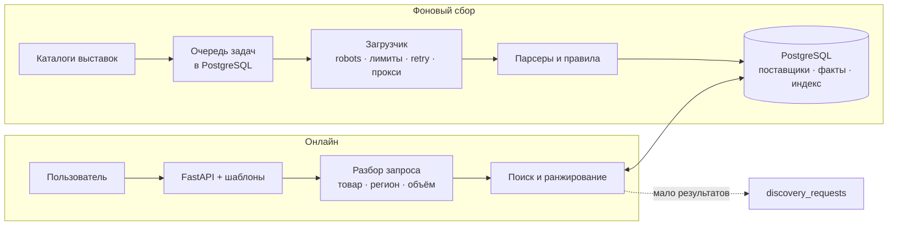
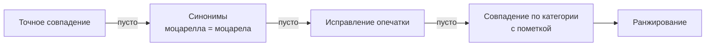
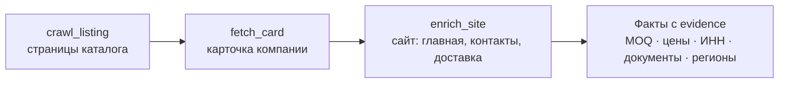

# Goulash Suppliers

Сервис поиска поставщиков продуктов питания для закупщиков кафе, ресторанов и производств.
Тестовое задание Goulash.tech, условие лежит в [PoC/assignment.pdf](PoC/assignment.pdf).

Пользователь вводит товар и регион. Сервис показывает подходящих поставщиков, объясняет, почему каждый
попал в выдачу, и помогает решить, кому звонить первым. У каждого факта есть источник и дата проверки.
Если значение не найдено, выводится «нет данных», а не ноль.

## Как пользоваться

1. **Поиск.** Введите запрос обычным языком, например `моцарела 2 кг Екатеринбург`. Сервис исправит
   опечатку, распознает город и количество. Регион и категорию можно задать фильтрами.
2. **Выдача** делится на две группы:
   - **связаны с регионом:** доставка в регион подтверждена, поставщик возит по всей России или у него
     там офис;
   - **доставка не подтверждена.**

   У каждой карточки указаны причины попадания и индикатор полноты.
3. **Карточка поставщика** содержит контакты, сайт, минимальный заказ, цены, документы и условия
   доставки. Рядом с каждым фактом показаны фрагмент текста и ссылка на страницу-источник. Ниже идут
   вопросы для звонка по недостающим данным и заметки.
4. **Сравнение.** Отметьте 2–6 поставщиков, и их условия встанут в одну таблицу.
5. **Шорт-лист** хранит выбранных поставщиков со статусами: «связаться», «связались», «переговоры»,
   «не подходит».

Для интеграций есть JSON API: `/api/search?q=...&region=...` и `/api/suppliers/{id}`.

## Архитектура

Сервис состоит из двух независимых частей с общей базой PostgreSQL:

- **Онлайн-поиск** читает только подготовленную базу. Он отвечает быстро и не обращается к внешним
  сайтам или LLM.
- **Фоновый сбор** обходит каталоги выставок и сайты поставщиков, извлекает факты и складывает их
  в базу.



### Поиск



Ранжирование учитывает признаки в порядке важности:

1. совпадение товара;
2. связь с регионом (подтверждённая доставка весит больше, чем офис в регионе);
3. профильность поставщика;
4. полнота карточки и наличие условий;
5. свежесть данных.

Используются PostgreSQL FTS и `pg_trgm` со справочником из 26 категорий, синонимов и городов. Всё
работает детерминированно, без LLM.

### Сбор



- **Очередь** работает на `SELECT ... FOR UPDATE SKIP LOCKED` с арендой задач. При ошибке задача
  повторяется с растущей задержкой, а блокировку сайта отправляют на ручную проверку.
- **Повторный прогон** ничего не дублирует. Наблюдения хранятся по ключу источник + выпуск + ID,
  поставщики сливаются по домену. Позиция обхода каталога сохраняется между запусками.
- **Загрузчик** собран из цепочки middleware. Прокси (`GOULASH_PROXIES`), ротация заголовков и
  headless-браузер добавляются новым звеном, адаптеры источников менять не нужно.

Исследование, проверка гипотез и целевая архитектура описаны в [PoC/PLAN.md](PoC/PLAN.md) и
[PoC/report.md](PoC/report.md).

## Источники

| Источник | Статус |
|---|---|
| Продэкспо-2026, каталог участников | подключён, пагинация с сохранением позиции |
| WorldFood Moscow 2026 | подключена только первая страница: остальные грузятся через AJAX |
| Сайты поставщиков | главная страница и до 3 страниц «контакты / доставка / о компании» |
| СППИ | не подключён: условия сайта запрещают копирование |

## Стек

| Задача | Технологии |
|---|---|
| Приложение | Python 3.12, FastAPI, Jinja2, немного vanilla JS |
| Хранилище, поиск, очередь | PostgreSQL |
| Сбор | httpx и `html.parser` |
| Деплой | Docker на Render или Koyeb, база на Neon (бесплатные тарифы) |

## Запуск локально

```sh
make db      # PostgreSQL в Docker на порту 5439
make venv    # .venv и зависимости
make run     # http://localhost:8000, пустая база заполняется из data/seed
```

Сбор и проверки:

```sh
make crawl PAGES=5   # 5 страниц каталога на источник, затем карточки и сайты
make stats           # покрытие данных и состояние очереди
make lint && make test
```

## Деплой

1. Создайте базу в [Neon](https://neon.tech) и скопируйте строку подключения.
2. В Render выберите New → Web Service, укажите этот репозиторий, Language: Docker, Instance: Free и
   переменную `DATABASE_URL`. Health check: `/healthz`.
3. При первом старте приложение создаст схему и загрузит каталог из `data/seed`.
4. Для еженедельного сбора добавьте секрет `DATABASE_URL` в GitHub Actions, workflow
   [collect.yml](.github/workflows/collect.yml) будет писать прямо в базу.

## Ограничения

- Минимальный заказ и цены поставщики публикуют редко, поэтому сервис предлагает уточнить их при звонке.
- Факты извлекаются правилами и вручную не проверяются, поэтому рядом всегда показан исходный фрагмент.
- Заметки и шорт-лист общие для всех пользователей: авторизации нет.
- GitHub Actions работает с зарубежных IP, и часть российских сайтов может не отвечать. Для регулярного
  сбора лучше российский VPS или прокси.
