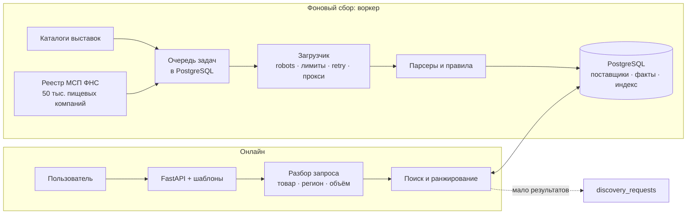
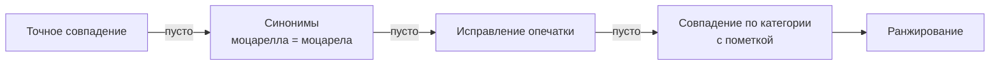
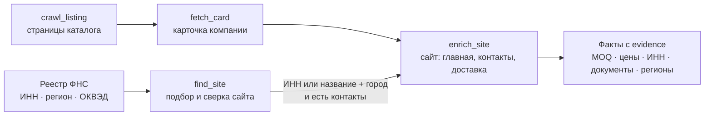

# Goulash Suppliers

Сервис поиска поставщиков продуктов питания для закупщиков кафе, ресторанов и производств.
Тестовое задание Goulash.tech, условие лежит в [PoC/assignment.pdf](PoC/assignment.pdf).

**Стенд:** https://goulash-example.onrender.com. Бесплатный инстанс засыпает без трафика, поэтому первый
запрос может идти около минуты.

Пользователь вводит товар и регион. Сервис показывает подходящих поставщиков, объясняет, почему каждый
попал в выдачу, и помогает решить, кому звонить первым. У каждого факта есть источник и дата проверки.
Если значение не найдено, выводится «нет данных», а не ноль.

## Как пользоваться

1. **Поиск.** Введите товар и город обычным языком, например `моцарела 2 кг Екатеринбург`. Сервис
   исправит опечатки, в том числе в городе, перенесёт город в фильтр «Регион» и распознает количество.
   Бренды (`сникерс`, `нескафе`) ищутся по своей категории с пометкой.
2. **Фильтры** применяются сразу: регион и категория (списки с поиском), «только связанные с регионом»,
   отдельные переключатели «есть телефон / e-mail / сайт / мин. заказ / цена / доставка / документы».
   Рядом с каждым переключателем — сколько поставщиков в выдаче им соответствуют. Применённые фильтры
   показаны над выдачей, каждый снимается крестиком.
3. **Выдача** делится на две группы:
   - **связаны с регионом:** доставка в регион подтверждена, поставщик возит по всей России или у него
     там офис;
   - **доставка не подтверждена.**

   У каждой карточки указаны причины попадания и «Данные: N из 9» — по клику видно, какие поля известны.
   Сортировка: по релевантности, по объёму данных, сначала с условиями, по свежести, по названию.
4. **Карточка поставщика** содержит контакты, сайт, минимальный заказ, цены, документы и условия
   доставки. Рядом с каждым фактом показаны фрагмент текста и ссылка на страницу-источник. Ниже идут
   вопросы для звонка по недостающим данным и заметки.
5. **Сравнение.** Отметьте 2–6 поставщиков, и их условия встанут в одну таблицу.
6. **Шорт-лист** хранит выбранных поставщиков со статусами: «связаться», «связались», «переговоры»,
   «не подходит».

Для интеграций есть JSON API: `/api/search?q=...&region=...&need=price` и `/api/suppliers/{id}`.

## Архитектура

Сервис состоит из двух независимых частей с общей базой PostgreSQL:

- **Онлайн-поиск** читает только подготовленную базу. Он отвечает быстро и не обращается к внешним
  сайтам или LLM.
- **Фоновый сбор** (воркер) обходит каталоги выставок и сайты поставщиков, подбирает сайты компаниям
  из реестра ФНС, извлекает факты и складывает их в базу.



### Поиск



Ранжирование учитывает признаки в порядке важности:

1. совпадение товара;
2. связь с регионом (подтверждённая доставка весит больше, чем офис в регионе);
3. профильность поставщика;
4. полнота карточки и наличие условий;
5. свежесть данных.

Используются PostgreSQL FTS и `pg_trgm` со справочником из 26 категорий, синонимов и городов. Всё
работает детерминированно, без LLM.

### Сбор



- **Воркер** — одна команда `python -m goulash cycle`: каталоги с сохранённой позиции, раз в месяц
  свежий реестр ФНС, подбор сайтов для следующей тысячи компаний. Запускается ежедневно в GitHub
  Actions ([collect.yml](.github/workflows/collect.yml)) или сервисом `worker` в docker compose на VPS.
- **Реестр ФНС** даёт юрлица с ИНН, регионом и видом деятельности (производство продуктов и напитков,
  оптовая торговля продуктами), но без контактов. Компания попадает в поиск, только когда найден её
  сайт, на нём есть её ИНН или полное название с городом, и есть телефон или e-mail.
- **Подбор сайта** по умолчанию бесплатный: варианты домена из названия, проверка DNS, сверка
  содержимого. Поисковики не парсятся. С ключом `YANDEX_SEARCH_API_KEY` используется Yandex Search API.
- **Очередь** работает на `SELECT ... FOR UPDATE SKIP LOCKED` с арендой задач. При ошибке задача
  повторяется с растущей задержкой, блокировку сайта отправляют на ручную проверку, обрыв соединения
  с базой переживается переподключением.
- **Повторный прогон** ничего не дублирует. Наблюдения хранятся по ключу источник + выпуск + ID,
  поставщики сливаются по домену. Архив реестра (2,2 ГБ) докачивается и чинится с места порчи.
- **Загрузчик** собран из цепочки middleware. Прокси (`GOULASH_PROXIES`), ротация заголовков и
  headless-браузер добавляются новым звеном, адаптеры источников менять не нужно.

Исследование, проверка гипотез и целевая архитектура описаны в [PoC/PLAN.md](PoC/PLAN.md) и
[PoC/report.md](PoC/report.md).

## Источники

| Источник | Статус |
|---|---|
| Продэкспо-2026, каталог участников | подключён полностью (144 страницы, около 1400 компаний) |
| WorldFood Moscow 2026 | подключена только первая страница: остальные грузятся через AJAX |
| Реестр МСП ФНС (открытые данные) | подключён: 50 тыс. пищевых юрлиц, в поиск попадают компании с найденным сайтом и контактами |
| Сайты поставщиков | главная страница и до 3 страниц «контакты / доставка / о компании» |
| СППИ | не подключён: условия сайта запрещают копирование |

Данные на стенде на 04.11.2026: **1519 поставщиков**, у 1364 есть телефон, 1037 сайтов разобрано.
В них 403 поставщика с документами, 193 с условиями доставки, 32 с минимальным заказом, 10 с ценами. Из реестра
ФНС проверено 3000 компаний из 50 138: у 103 найден сайт с контактами, ещё 25 уже были в каталоге. Дальше
воркер проверяет по 1000 компаний в день.

## Стек

| Задача | Технологии |
|---|---|
| Приложение | Python 3.12, FastAPI, Jinja2, немного vanilla JS |
| Хранилище, поиск, очередь | PostgreSQL |
| Сбор | httpx и `html.parser` |
| Деплой | Docker на Render или Koyeb, база на Neon (бесплатные тарифы) |

## Запуск локально

```sh
make db      # PostgreSQL в Docker на порту 5439
make venv    # .venv и зависимости
make run     # http://localhost:8000, пустая база заполняется из data/seed
```

Сбор и проверки:

```sh
make crawl PAGES=5   # 5 страниц каталога на источник, затем карточки и сайты
make registry        # скачать свежий реестр ФНС (2,2 ГБ) и загрузить пищевые компании
make discover LIMIT=300   # подобрать сайты для 300 компаний реестра
make cycle           # полный цикл воркера, как в ежедневном запуске
make stats           # покрытие данных и состояние очереди
make lint && make test
```

## Деплой

1. Создайте базу в [Neon](https://neon.tech) и скопируйте строку подключения.
2. В Render выберите New → Web Service, укажите этот репозиторий, Language: Docker, Instance: Free и
   переменную `DATABASE_URL`. Health check: `/healthz`.
3. При первом старте приложение создаст схему и загрузит каталог из `data/seed`.
4. **Воркер.** Добавьте секрет репозитория `DATABASE_URL` (Settings → Secrets and variables → Actions →
   Repository secret). Workflow [collect.yml](.github/workflows/collect.yml) запускается ежедневно и
   вручную. На VPS: `docker compose --profile worker up -d worker`. Опционально секреты
   `YANDEX_SEARCH_API_KEY` и `YANDEX_FOLDER_ID` включают подбор сайтов через Yandex Search API.

## Ограничения

- Минимальный заказ и цены поставщики публикуют редко, поэтому сервис предлагает уточнить их при звонке.
- Факты извлекаются правилами и вручную не проверяются, поэтому рядом всегда показан исходный фрагмент.
- Заметки и шорт-лист общие для всех пользователей: авторизации нет.
- GitHub Actions работает с зарубежных IP. Проверено: сайты поставщиков открываются так же, как из
  России (около 75%); остальные — просроченные сертификаты, мёртвые домены, robots.txt и антибот.
- Бесплатный подбор сайта по названию находит сайт с контактами примерно у 3–4% компаний реестра:
  у остальных домен не совпадает с юрназванием. Сверка строгая: короткое название засчитывается только
  в юридической форме («ООО «Энергия»»), иначе нужен ИНН. Yandex Search API должен давать заметно больше.
